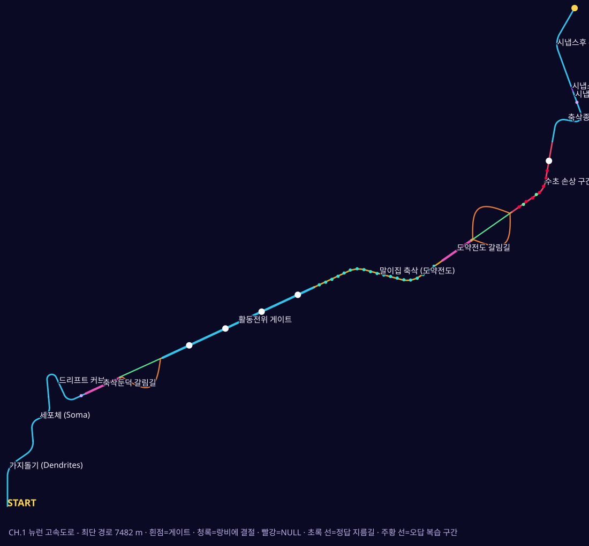

# NERVE RUNNER: 신경계의 마지막 신호

신경정보를 의인화한 노란 별 **STAR-01**이 신경섬유를 따라 질주하며, 신경해부생리학 지식으로 올바른 경로를 찾아가는 **교육용 3D 레이싱 게임**(Unity 6 · URP · iPad 가로 화면)입니다.

> **현재 상태:** CHAPTER 1 "뉴런 고속도로" 첫 플레이 가능 버전. 게임 로직은 헤드리스 테스트로 처음부터 끝까지 검증했고 모든 스크립트는 컴파일 검증을 통과했습니다. **Unity 에디터·iPad에서의 실행은 아직 확인하지 못했습니다** (작업 환경에 Unity가 없음). 자세한 내용은 [STEP 3 보고서](docs/STEP3_작업보고.md)를 보세요.

## 열어 보기

1. Unity Hub에서 **Unity 6000.3.11f1 이상**(URP)으로 `NerveRunner/` 폴더를 엽니다. 패키지는 `Packages/manifest.json`에서 자동 설치됩니다.
2. `Assets/Scenes/NerveRunner.unity`를 열고 Play. (어떤 빈 씬에서도 `GameRoot`가 게임 전체를 코드로 생성합니다.)
3. iPad: Build Profiles ▸ iOS ▸ Build → Xcode에서 서명 후 설치. 번들 ID `com.nerverunner.edu`, iPad 전용, 가로 화면.

### 조작
| 동작 | iPad | 키보드 (에디터) |
|---|---|---|
| 좌/우 조향 | ◀ ▶ 버튼 | ← → / A D |
| 점프 | 점프 | Space / ↑ / W |
| 드리프트 (누른 채 커브 방향 조향, 놓으면 미니 터보) | 드리프트 | Z / Ctrl / ↓ / S |
| 부스터 | 부스터 | Shift / X |
| 일시정지 | II | Esc / P |
| 자동조종 (테스트용) | — | F2 (에디터 전용) |

## 구성
| 경로 | 내용 |
|---|---|
| `NerveRunner/Assets/NerveRunner/Scripts/Core` | 순수 C# 게임 규칙: 트랙 그래프, 별 이동/드리프트/부스트, 갈림길·게이트 판정, 학습 기록 |
| `NerveRunner/Assets/NerveRunner/Scripts/Unity` | 별 캐릭터, 트랙·배경 표현, 카메라, 터치 입력, 모든 화면, 시냅스 미니게임 |
| `NerveRunner/Assets/NerveRunner/Resources/NerveRunner` | 문제은행·신경 도감·스토리 JSON (코드 수정 없이 편집 가능) |
| `NerveRunner/Assets/ThirdParty/NeonRacer` | 재사용한 Neon Racer 코드 (MIT) |
| `Tools/SimTests` | 헤드리스 플레이 테스트: `dotnet run --project Tools/SimTests` |
| `Tools/CompileCheck` | Unity 없이 컴파일 검증: `Tools/CompileCheck/setup_refs.sh && dotnet build Tools/CompileCheck` |
| `docs/` | STEP 1 조사 보고서 · STEP 2 설계 · STEP 3 작업 보고 · 코스 지도 |

## 문서
- [STEP 1. 오픈소스 후보 조사·선정](docs/STEP1_오픈소스_조사보고서.md) — Neon Racer 선정 (가중 점수 8.05)
- [STEP 2. 개발 설계](docs/STEP2_개발설계.md)
- [STEP 3. CH.1 작업 보고](docs/STEP3_작업보고.md)

## 라이선스·출처
레이싱 기반 코드는 [Neon Racer](https://github.com/pinchasVaknin/neon-racer) (MIT, © 2026 Pinchas Vaknin)를 재사용·각색했습니다. 파일별 출처는 [THIRD_PARTY_NOTICES.md](THIRD_PARTY_NOTICES.md)를 보세요. 외부 아트·사운드·폰트 파일은 포함하지 않으며 모두 코드로 생성합니다.
