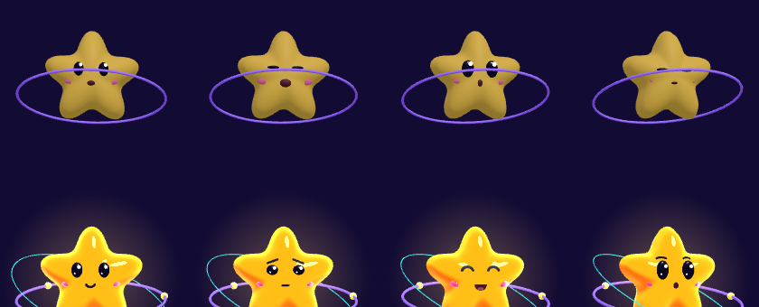
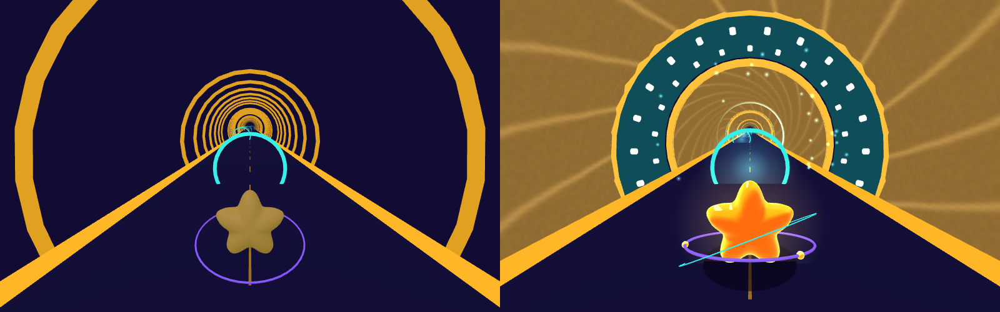

# NERVE RUNNER 2.0 — PHASE 1 보고: STAR-01 · 도약전도 터널

> 작업 브랜치: `claude/nerve-runner-visual-upgrade` (원본 `claude/nerve-runner-racing-game-wkgzek`은 그대로 보존)

## ⚠ 검증 범위
이 작업 환경에는 Unity와 iPad가 없습니다. 그래서 **Unity에서 실제로 렌더링된 화면은 아직 아무도 보지 않았습니다.** 확인한 것과 확인하지 못한 것은 아래와 같습니다.

| 항목 | 결과 |
|---|---|
| C# 컴파일 (Unity 참조 DLL, 두 입력 경로) | ✅ 오류 0 |
| 게임 로직 회귀 테스트 | ✅ 1.0과 수치 동일 (176.2 s, 7/7, 결절 19/19) — 이동·조작감 코드는 바뀌지 않음 |
| 터널 형상 검사 (도로·별·링이 수초 안에 들어가는지) | ✅ 통과 |
| 형태·비례 미리보기 | ✅ 같은 수식을 three.js로 옮겨 렌더 (아래 이미지, **Unity 화면 아님**) |
| 새 URP 셰이더 2개 컴파일 | ❌ **미검증** — 셰이더 컴파일러를 실행할 수 없었음. 실패하면 자동으로 1.0 재질로 대체됨 |
| Unity 실제 화면, 프레임레이트, iPad | ❌ 미확인 |

## 1. 변경 전후 비교

### STAR-01 (위: 1.0 / 아래 두 줄: 2.0 — 기본·집중·기쁨·놀람 / 충돌·정답·오답·승리)


### 도약전도 터널 (왼쪽 1.0 / 오른쪽 2.0, 추적 카메라 시점)


*미리보기 소스: `Tools/VisualPreview/` (three.js). Unity의 조명·안개·블룸·파티클과는 차이가 있습니다.*

| | 1.0 | 2.0 |
|---|---|---|
| 별 재질 | 단색 발광 | 2톤 카툰 명암 + 림 글로우 + 하이라이트 (`NerveRunner/ToonRim`) |
| 얼굴 | 구 크기 조절 | 표면에 붙는 데칼 도형: ^ ^, > <, 반짝 눈, 눈썹 4종, 눈물, 입 5종 |
| 표정 | 7종(구분 약함) | 9종: 기본·집중·기쁨·놀람·충돌·치유·승리·**정답·오답** |
| 애니메이션 | 기울기·드리프트·점프·부유·부스트 | **동일 값 유지** + 가속 앞기울기, 드리프트 미끄럼 흔들림, 점프 늘어남/착지 찌그러짐, 충돌 흰 번쩍임+떨림, 승리 댄스 |
| 이펙트 | 불투명 꼬리 1개 | 후광, 접지 그림자, 그라데이션 꼬리, 전기 꼬리 2개, 부스트 번개, 드리프트 스파크(미니터보 단계 색: 하늘→파랑→주황→분홍), 속도선, 충돌·정답·오답·착지·복구·터보·결절 폭발, 승리 반짝이 |
| 에너지 링 | 1개 (얼굴을 가림) | 2개, 얼굴 아래로 지나가도록 기울기 수정 |
| 카메라 | 7.5 m 뒤, 3.2 m 위 | 6.4 m / 2.6 m (별이 더 크게), 코너 안쪽 바라보기, 드리프트 4° 기울기, 점프는 절반만 따라감, 흔들림 강도 설정 |
| 터널 | 금색 고리 | **수초 관**(감긴 막 무늬, 끝이 가늘어지는 결절주위부) + **랑비에 결절**(노출된 축삭막 띠 + Na+ 통로 44개) |
| 결절 통과 | 링 색 변경 | 결절 번쩍임 + **Na+ 유입 입자**(안쪽으로) + **펄스 링이 다음 결절까지 질주**(수초 아래 빠른 수동 전파) + 다음 목표 결절 깜빡임 |

### 학습 정확성
- 수초 = 축삭을 감싼 절연 막(금빛 관), 랑비에 결절 = 수초 사이 노출된 축삭막(청록 띠)이고 전압개폐 Na+ 통로가 밀집한 곳입니다.
- 활동전위는 결절마다 **재생성**됩니다. 펄스는 다음 결절까지만 달리고, "순간이동"으로 표현하지 않았습니다.
- 게임상 과장을 화면 안내와 도감에 명시했습니다. 실제 결절은 약 1 μm, 마디사이는 약 0.2~2 mm입니다.
- 화면 표지판 2개를 추가했습니다: "말이집(수초): 축삭을 감싼 절연층 → 이 구간은 빠르게 수동 전도", "랑비에 결절: Na+ 통로 밀집 → 활동전위가 여기서 재생성".

## 2. 변경한 코드와 파일

| 파일 | 변경 |
|---|---|
| `Shaders/NR_ToonRim.shader` (신규) | URP 카툰 셰이더: 램프 명암, 앰비언트, 토온 하이라이트, 프레넬 림, 안개, DepthOnly/DepthNormals 패스 |
| `Shaders/NR_FX.shader` (신규) | URP 투명 이펙트: 가산/알파 블렌드 전환, 버텍스 컬러(파티클·트레일), 안개 페이드 |
| `Scripts/Unity/NRMats.cs` (신규) | 셰이더 사용 가능 여부 확인 → **불가 시 1.0 URP/Lit로 자동 대체**, 품질 Low/Medium/High, 이펙트 텍스처 생성 |
| `Scripts/Unity/StarFace.cs` (신규) | 별 표면 높이 함수, 스트로크·채움 데칼 메시 생성 |
| `Scripts/Unity/StarFx.cs` (신규) | 별 이펙트 전체 (파티클 상한은 품질 설정에 비례) |
| `Scripts/Unity/StarVisual.cs` | 재질·얼굴·표정·반응·찌그러짐·승리 추가 (1.0 모션 값 보존) |
| `Scripts/Unity/SaltatoryTunnelView.cs` (신규) | 수초 관, 결절주위부, 결절 막 + Na+ 통로, 유입 입자, 펄스, 다음 결절 표시, 학습 표지판 |
| `Scripts/Unity/TrackView.cs` | 수초 구간을 새 터널로 교체(1.0 함수는 남겨 둠), 결절 링 안쪽 글로우 |
| `Scripts/Unity/ChaseCamera.cs` | 프레이밍·코너·드리프트·점프·흔들림 강도 |
| `Scripts/Unity/RaceController.cs` | 새 포즈/카메라 입력과 반응 이벤트 연결 (시뮬레이션 로직은 변경 없음) |
| `Scripts/Unity/GameRoot.cs`, `GameUI.cs`, `Core/Learning.cs` | 설정: 그래픽 품질(자동/낮음/중간/높음), 카메라 흔들림(끔/약하게/보통) |
| `Scripts/Unity/MeshKit.cs` | 별 팔 모양 파라미터, `Track()` 메시 해제 등록 |
| `Resources/NerveRunner/VariantKeep_ToonRim.mat`, `VariantKeep_FX.mat` | 빌드에 새 셰이더가 포함되도록 |
| `Resources/NerveRunner/story_ch1.json`, `codex_ch1.json` | 터널 설명 + 과장 고지 |
| `Tools/SimTests/Program.cs` | [8] 터널 여유 공간 검사 + 메시 예산 출력 |
| `Tools/VisualPreview/*` | 디자인 미리보기 |

## 3. 사용한 AI 도구와 에셋
- **이번 단계에서 외부 AI 도구로 만든 결과물은 없습니다.** 모든 그래픽은 코드와 직접 작성한 셰이더입니다.
- Pollo AI는 연결되어 있지만 **유료 크레딧(잔여 20)을 쓰므로 승인을 기다리는 중**입니다 → [`VISUAL2_AI도구_프롬프트.md`](VISUAL2_AI도구_프롬프트.md)
- Meshy AI와 Asset Store는 이 환경에서 접속할 수 없었습니다. 프롬프트와 임포트 절차만 제공합니다.
- **STAR-01을 외부 AI 모델로 바꾸지 않은 이유:** 코드 메시로도 원하는 형태가 나오고, 얼굴 데칼이 곡면에 정확히 붙으며, 찌그러짐·표정과 바로 연동되고, 폴리곤 수를 조절할 수 있기 때문입니다.
- 새로 추가된 외부 에셋 파일은 0개입니다 (텍스처·파티클 모두 코드 생성).

## 4. Unity 적용 결과
- 코드와 셰이더는 프로젝트에 적용되어 있고 C# 컴파일은 통과했습니다. **Unity 에디터에서의 실제 화면은 확인하지 못했습니다.**
- 셰이더 안전장치:
  - `Shader.Find` 결과가 없거나 지원되지 않으면 1.0 재질로 자동 대체되고, 콘솔에 `[NerveRunner] ... fallback` 경고가 남습니다.
  - 투명 효과(후광·파티클 등)는 FX 셰이더가 없으면 생략됩니다.
  - 화면이 이상하면 설정 → 그래픽 품질 **"낮음"**을 선택하면 카툰 셰이더를 쓰지 않습니다(앱 재시작 후 적용).

## 5. 테스트 결과
```
dotnet build Tools/CompileCheck                 -> Build succeeded
dotnet build Tools/CompileCheck -p:Legacy=true  -> Build succeeded
dotnet run --project Tools/SimTests             -> ALL CHECKS PASSED
  [3] autopilot 176.2 s, 7/7, rings 19/19, walls 0   (1.0과 동일)
  [8] road edge 6.46 m / STAR-01 5.38 m < tapered sheath 6.72 m;  node rings 6.00 m < axon membrane 7.4 m
```

## 6. 성능 영향 (계산값, 실측 아님)
| 항목 | 1.0 | 2.0 |
|---|---|---|
| 터널 정점 | 금색 고리 약 150개 × 174 ≈ 26k | 수초 관 37.6k (정적 배칭) + 결절 22.9k |
| 터널 드로우콜 | 배칭 2~3 | 배칭 3 + 결절 38 (안개 520 m·절두체로 화면에는 약 10개 결절만) |
| 별 드로우콜 | 약 30 | 약 50 (얼굴 데칼·트레일 3·번개 2·파티클 4·후광·그림자) |
| 파티클 상한 | 0 | 별 약 220 + 터널 180 (높음 기준) → 중간 약 65%, 낮음 약 30% |
| 투명 오버드로 | 거의 없음 | 후광(4.4 m 쿼드) 1장, 블롭 그림자 1장, 속도선 |
| iPad 기본값 | — | **중간** (자동). 블룸은 1.0처럼 데스크톱 높음에서만 |

목표 60 FPS 달성 여부는 **iPad 실기기에서 측정해야 알 수 있습니다.** Xcode Instruments 또는 Unity Profiler로 측정해 주세요.

## 7. 아직 확인하지 못한 사항
1. 새 셰이더 2개가 Unity 6000.3 / Metal에서 오류 없이 컴파일되는지 (분홍색이 나오면 셰이더 오류)
2. 카툰 명암 방향: 장면의 방향광이 보라색 0.7이라 그늘 쪽이 너무 진하거나 연할 수 있음
3. 얼굴 데칼이 몸체와 겹쳐 깜빡이는지 (표면에서 0.012 띄움)
4. 후광·속도선이 글자나 트랙을 가리지 않는지, 블룸(데스크톱)이 과한지
5. 수초 관 내부 밝기(Emission 0.34)와 도로 가독성
6. 결절 펄스가 너무 빠르거나 느린지 (160 m/s)
7. iPad 프레임레이트, 발열, 파티클 부하
8. 품질 설정 변경 후 재시작 시 정상 반영되는지

## 8. 다음 단계
1. **사용자:** 이 브랜치를 Unity에서 열어 §7 항목 확인 → 스크린샷/콘솔 공유
2. 결과에 맞춰 셰이더·색·밝기 조정
3. Pollo 콘셉트 아트 생성 여부 결정 (10 크레딧)
4. PHASE 2: 뉴런 고속도로 배경(거대 뉴런·가지돌기·세포체), 시냅스 정거장, 손상 구간 개선
